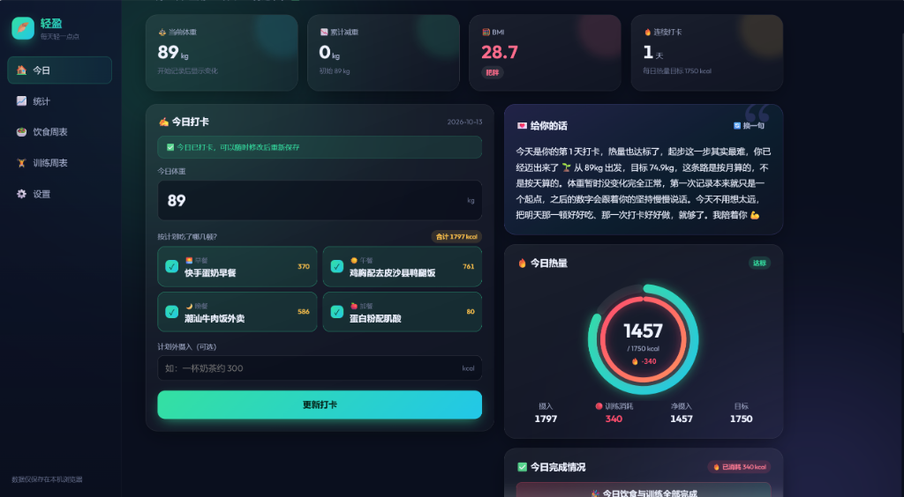
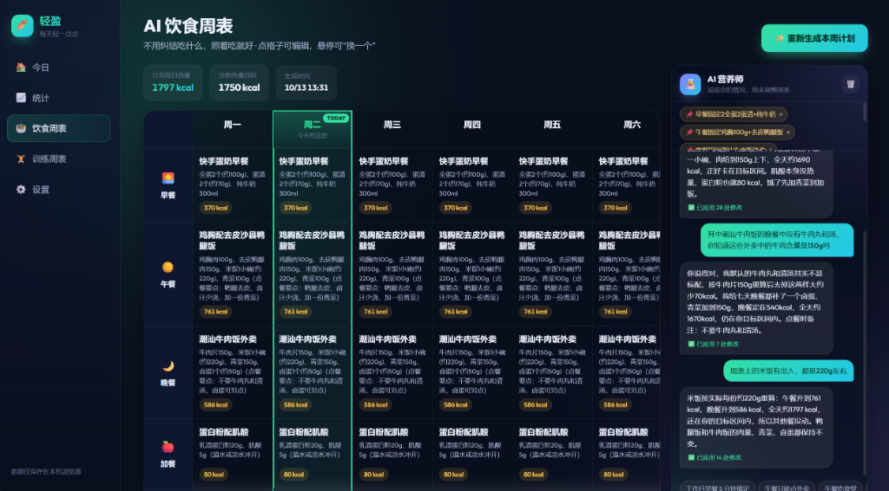
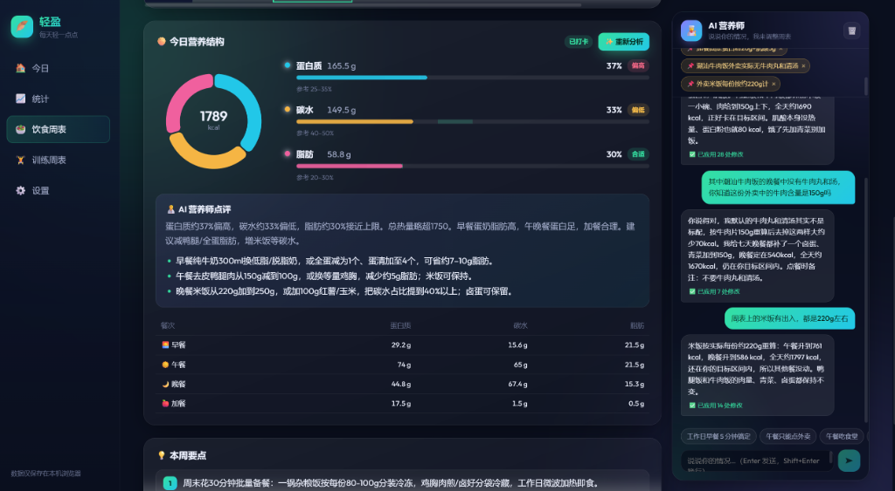
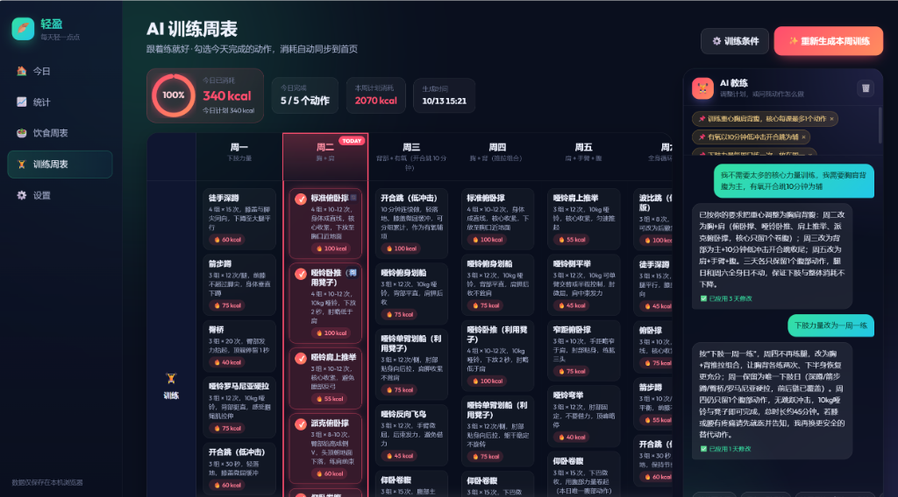
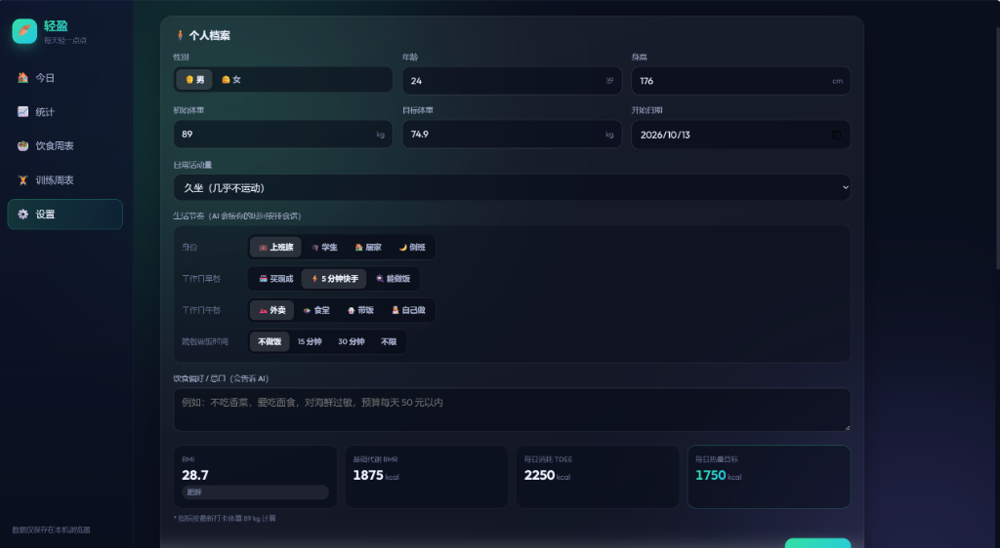

# 轻盈 · 减重记录（looseweight-demo）

个人自用的减重 Web 应用：每日体重打卡 → 趋势图表与统计 → AI 一周减脂饮食周表 + 训练周表 → 打卡后自动算热量（摄入 − 训练消耗）并送上鼓励。
数据只保存在本机浏览器（localStorage，key：`looseweight-v1`）。

## 效果展示

**今日** · 体重打卡、热量圆环（外圈净摄入 / 内圈红色训练消耗）、今日完成情况



**AI 饮食周表** · 7 天 × 4 餐，右侧 AI 营养师对话调整食谱



**今日营养结构** · 三大营养素热量占比饼图、偏低/合适/偏高评级、AI 点评与建议



**AI 训练周表** · 勾选今日动作，消耗同步首页；右侧 AI 教练按天调整计划



**个人档案** · 生活节奏决定食谱难度，自动计算 BMI / BMR / TDEE / 每日热量目标



## 启动

```powershell
npm install      # 首次
npm run dev      # 打开 http://localhost:5173
```

其他命令：`npm test`（Vitest 单测）、`npm run build`（类型检查 + 打包）、`npm run preview`（预览打包结果，同样带 AI 代理）。

## 配置 AI

1. 进入「设置 → AI 配置」，点击预设（DeepSeek / 通义千问 / Kimi / OpenAI）自动填好 Base URL 和模型名，也可以手动填任何 OpenAI 兼容接口。
2. 填入 API Key（只存在本机，导出备份时不包含）。
3. 点「测试连接」，提示成功即可。

| 服务 | Base URL | 默认模型 |
|---|---|---|
| DeepSeek | https://api.deepseek.com | deepseek-flash |
| 通义千问 | https://dashscope.aliyuncs.com/compatible-mode/v1 | qwen-plus |
| Kimi | https://api.moonshot.cn/v1 | moonshot-v1-8k |
| OpenAI | https://api.openai.com/v1 | gpt-4o-mini |

**跨域说明：** 默认请求发往本地 `/ai-proxy/*`，由 Vite 中间件按请求头 `x-target-base` 转发到真实地址（见 `vite.config.ts`），所以必须通过 `npm run dev` / `npm run preview` 访问。“直连模式”只适用于本身支持 CORS 的服务。

未配置 AI 时，打卡鼓励使用内置语料，饮食周表 / 训练周表页会提示先去配置。

## 使用流程

1. 首次打开 → 填写个人档案（身高、体重、目标、年龄、活动量、饮食偏好）→ 自动算出 BMI / BMR / TDEE / 每日热量目标。
2. 「饮食周表」→ 生成我的一周食谱（7 天 × 4 餐，今天这一列高亮）；点格子手动编辑，悬停点「🔄 换一个」只替换这一餐。周表下方「🥧 今日营养结构」点「分析今日饮食」，AI 估算三大营养素，显示热量占比饼图、偏低/合适/偏高评级和改进建议（已打卡按已吃的餐，未打卡按计划预览）。
3. 「训练周表」→ 首次先填训练条件（场地、单次时长、每周天数、水平、身体限制）→ 生成一周训练（今天这一列红色高亮）；点格子手动编辑。完成后勾选今天的动作，或点「一键完成今日训练」，消耗热量会同步到「今日」的红色圆环、今日进度卡片，以及「统计」的红色柱。右侧 AI 教练可以答疑，也可以按天调整计划。
4. 「今日」→ 输入体重、勾选按计划吃了哪几顿、填计划外摄入 → 打卡。自动计算热量、生成鼓励、解锁徽章。是否达标按净摄入判断（摄入 − 训练消耗）。
5. 「统计」→ 体重趋势（7 日均线 + 目标线）、热量图（摄入柱 + 红色消耗柱 + 净摄入线）、预计达成日期、历史记录编辑/删除。
6. 「设置」→ 徽章墙、导出 / 导入 JSON 备份（含训练数据）、清空数据。

## 目录

```
src/
  domain/    纯计算：calc（BMI/BMR/TDEE/统计/预测）、badges（连续打卡/徽章）、encourage（离线鼓励语）、workout（训练消耗/完成状态/净摄入）、nutrition（营养占比/评级）
  ai/        client（OpenAI 兼容调用 + 错误归一化）、prompts（三套提示词）、parse（JSON 提取与校验）、workoutPrompts / parseWorkout（训练教练提示词与解析）、nutritionPrompts / parseNutrition（营养分析）
  store/     useStore（Zustand + persist）、toast、dataio（导入校验）
  services/  encourage（AI 鼓励 + 离线兜底）
  hooks/     useWide（宽屏判断）
  components/ pages/ styles/
```

> AI 饮食与训练建议仅供参考，如有慢性疾病、伤病或其他身体不适，请咨询医生、注册营养师或专业教练。
